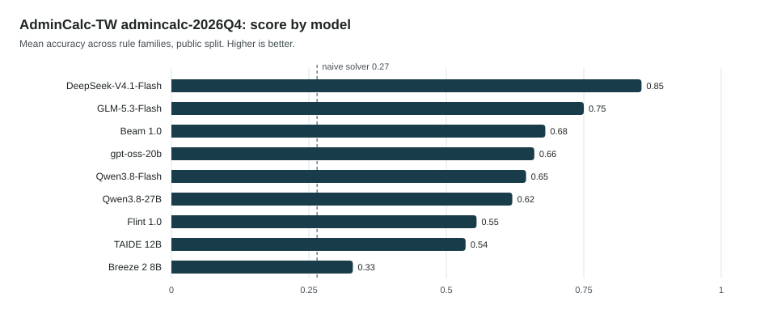
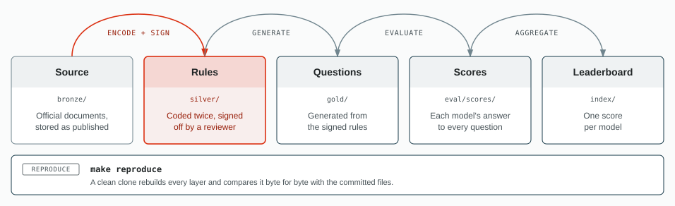

# AdminCalc-TW

AdminCalc-TW is a benchmark of Taiwan administrative calculations. Each question gives a short task in Traditional Chinese, such as checking a business ID number (統一編號) or converting a Minguo (ROC) year, and asks for a single integer. Code-based rules, rather than human labeling, determine the correct answers. Every question traces back to the official government document that defines its rule.

This repository holds release **admincalc-2026Q4**: the rule code, the public question sets, the scores, and everything needed to rebuild them from the source documents.

- Dataset (questions and per-question results): https://huggingface.co/datasets/taiwaneval/AdminCalc-TW. For each model, it includes the parsed answer, score, and error attribution for every question. Raw model outputs are not published.
- License: code Apache-2.0; data CC BY 4.0 (see [Licenses](#licenses)).



## Reproduce

```bash
make reproduce
```

This command clones the current commit into a temporary directory, creates a fresh virtual environment from `requirements.txt` alone, rebuilds every layer from its committed inputs, and compares the result byte for byte against the committed files. Raw evaluation logs contain model output text and are not published. The command therefore rebuilds the index from the score table in `eval/scores/<release>/`, which was extracted from those logs. Reproduction takes about one minute and requires Python 3.12, Node.js 22 (to run the JavaScript rule implementations), and git. If any layer differs, the command prints the layer, the file, and the first difference, then exits with status 1.

## What is in a release

| Family | Version | Public questions |
| --- | --- | --- |
| `ban_checksum` | 0.1.1 | 100 |
| `minguo_year` | 0.1.1 | 100 |

- `ban_checksum` covers the check-digit rule for the 8-digit business ID number (營利事業統一編號), as revised by the Ministry of Finance: the weighted digit sum must be divisible by 5 (previously 10). Questions ask whether a number is valid, the smallest valid last digit for a 7-digit prefix, or how many numbers in a list are valid. About half the questions have a different answer under the old rule.
- `minguo_year` covers conversion between Minguo (ROC) years and Gregorian years (ROC year N = AD N + 1911) for ROC years 1 to 120: ROC to AD, AD to ROC, and the AD year of an ROC date.

The admincalc-2026Q4 results cover 9 model targets. A target pairs a model with its serving setup (`model@quantization@hardware@mode`). For example, a 4-bit build on a local Mac is a different target from the same model served through an API.

Notes on the targets in this release:

- `qwen3.8-flash@api@bailian@max` and `qwen3.8-27b@api@bailian@max` are served through Alibaba Cloud Bailian. They are the same models as the LaborCalc-TW targets `qwen3.8-flash@api@opencode@max` and `qwen3.8-27b@optiq4-mlx@mac-studio-applem1ultra@max`, but with a different provider and settings, so their scores are not directly comparable across the two datasets.
- For `qwen3.8-27b@api@bailian@max`, Bailian's content filter rejected one `minguo_year` question (`0050`) on every retry, and no answer was produced. Under the scoring rules, it counts as wrong.



The work is organized in layers, and each layer is built only from the one before it:

| Layer | Path | What it holds |
| --- | --- | --- |
| bronze | `bronze/<source_id>/` | The provenance record of each official source document: publisher, URL, retrieval time, license, and the sha256 of the file as fetched. |
| silver | `silver/families/<id>/` | A rule family: `spec.yaml` (the rule in prose, with its source and scope), two independent implementations (`rule.py` and `rule.js`, cross-checked by `test_agreement.py`), question templates, the parameter sampler, and `hypotheses.py` (wrong rules that models are likely to apply, such as the pre-revision check-digit rule). |
| gold | `gold/releases/<release>/public/` | Generated questions (`*.jsonl`) and a per-family manifest recording the sha256 of the spec, rule, templates, and sampler, the generator version, and the date the questions were generated for. |
| eval | `eval/tasks/rules_registry.py` | The [Inspect AI](https://inspect.aisi.org.uk/) task that runs a model on a question set and scores it. |
| eval | `eval/scores/<release>/` | The score table: one row per target and question (`items.jsonl`) with the parsed integer answer, whether it was correct, and error attribution, plus one record per evaluation run (`runs.json`). It contains no model output text. The index is computed from this table. |
| index | `index/<release>/` | Scores per target and family (`index.json`), per-question results (`items.csv`), and a data bundle for the website (`site-data/`). |

## How questions are made

1. A person reads the official source document and writes the rule in `spec.yaml`, specifying which parts of the document it encodes, the procedure, and what it leaves out.
2. The rule is implemented twice, independently, in Python and in JavaScript. A family is accepted only when both implementations agree on every golden case and on random inputs.
3. A sampler draws parameters to cover every branch of the rule, including cases where the old and the current rule disagree.
4. Templates render the parameters into natural Traditional Chinese, varying the wording, the numeral style, and irrelevant details. Some questions come in pairs that ask the same thing in different words, to measure whether rewording changes the answer.
5. A named reviewer signs off on a family by recording the sha256 of its spec, rule, templates, and sampler in `reviews.yaml`. Changing even a single character in any of these files voids the sign-off. A release can only be built from signed families.

## Scoring

Each answer is a single integer. The scorer takes the integer after "答案：" if present, or otherwise the last integer in the response, and compares it with the gold answer. Questions that time out or fail count as wrong and stay in the denominator. A target's headline score is the unweighted mean of its family accuracies. The weights are in `datasets.yaml`, and `eval/aggregate.py` can be rerun with different ones.

Both `eval/attribute_errors.py` (for raw logs) and `eval/score_table.py` (for the published score table) compare each wrong answer with the outputs that the wrong rules in `hypotheses.py` would produce. A match shows only that the numbers agree. It does not prove that the model applied that rule.

## Limitations

- This release has 2 rule families. It measures a narrow procedural skill, not general knowledge of Taiwan's administration.
- Only the public split is released. A private split, generated with a secret salt, is kept to detect overfitting and is not published.
- Each target ran once per family, so this release has no figures for run-to-run variance.
- Error attribution reflects numerical agreement with a wrong rule, not the model's reasoning.
- The rules model the source documents for evaluation purposes only. A correct score does not mean a model's answers are reliable for real filings.

## Licenses

- Code: Apache-2.0 (`LICENSE`).
- Question sets, scores, and other data: CC BY 4.0 (`LICENSE-DATA.md`).
- The source documents are published by the Ministry of Finance Fiscal Information Agency and the Ministry of the Interior Department of Household Registration under the Open Government Data License, version 1.0. Each `bronze/<source_id>/provenance.json` records the publisher and URL.

## Citation

See `CITATION.cff`, or:

```bibtex
@misc{admincalc_tw_admincalc-2026Q4,
  title  = {AdminCalc-TW: a benchmark of Taiwan administrative calculations},
  author = {Ku, Calvin},
  year   = {2026},
  note   = {Release admincalc-2026Q4},
  url    = {https://github.com/taiwaneval/admincalc-tw}
}
```

---

## 中文說明

AdminCalc-TW 是一套台灣行政計算的評測。每一題用一段正體中文給出一項任務，例如檢查營利事業統一編號，或是換算民國年，請模型回答一個整數。正確答案由寫成程式的規則算出，不靠人工標註；每一題都能回溯到定義該規則的政府文件。

本儲存庫收錄 **admincalc-2026Q4** 這個 release 的完整內容，包含規則程式、公開題集、分數，以及從來源文件重建這些資料所需的一切。執行 `make reproduce` 後，程式會把目前的 commit clone 到暫存目錄，逐層重建所有檔案，再與已提交的檔案逐 byte 比對。

這一版有兩個規則 family：

- `ban_checksum`：營利事業統一編號的檢查碼，依財政部修正後的現行邏輯（加權和能被 5 整除，修正前是 10）。題型有判斷號碼是否符合邏輯、前 7 碼可配的最小有效第 8 碼，以及清單中符合邏輯的號碼個數。約一半題目照修正前規則作答會得到不同答案。
- `minguo_year`：民國年與西元年換算（民國 N 年 = 西元 N + 1911 年），範圍是民國 1–120 年。題型有民國年換西元年、西元年換民國年，以及從民國日期取出西元年份。

模型作答的原始紀錄不公開。`eval/scores/<release>/` 下的逐題得分表記錄了每個評測目標在各題擷取出的整數答案、對錯與錯誤歸因，分數也由這張表重算。

資料按層級組織：bronze 存放來源文件的來源紀錄（發布機關、網址、取得時間、授權與原檔 sha256）；silver 是各規則 family（規格、Python 與 JavaScript 兩份獨立實作、題目模板、抽樣器與常見錯誤規則）；gold 收錄產生的題集，以及記錄各檔案 sha256 的 manifest；index 彙整各評測目標的分數。

使用與解讀時要注意幾項限制：本 release 只有 2 個規則 family；只釋出 public 題集，private 題集不公開；每個評測目標在每個 family 都只跑過一次，所以沒有多次執行的變異數據；錯誤歸因只代表數字與某個錯誤規則相同，不代表模型真的這樣推理。這些規則是為評測而設計的模型，答對不代表模型的答案可直接用於實際申報。

來源文件由財政部財政資訊中心與內政部戶政司依政府資料開放授權條款－第 1 版提供。
